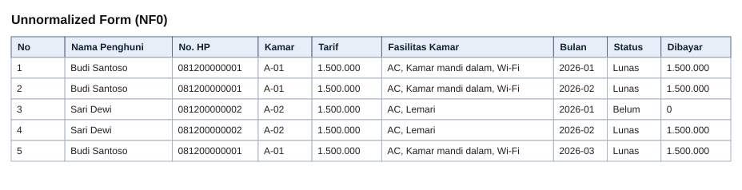
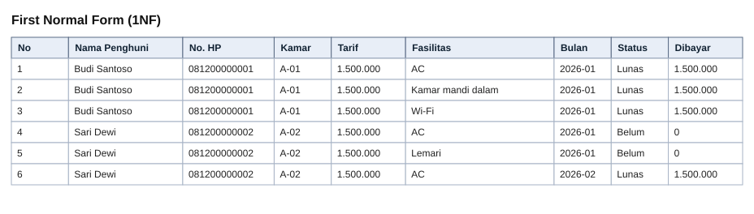
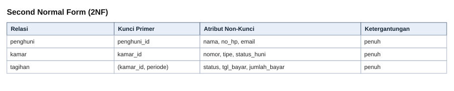
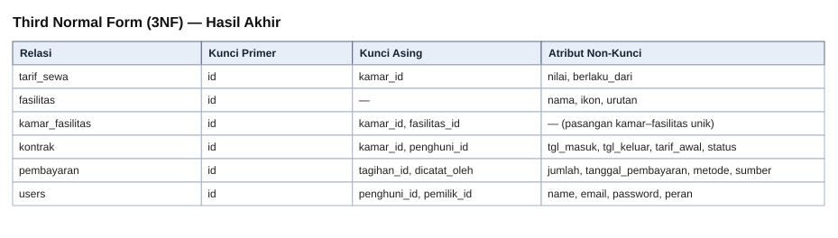
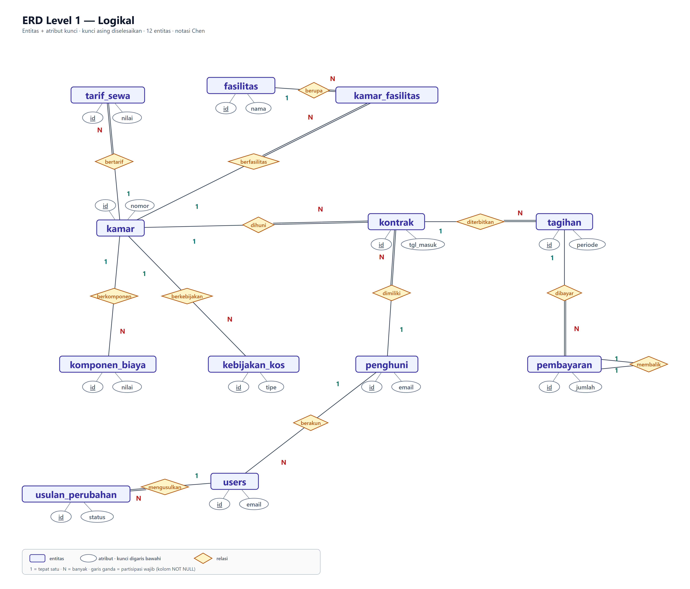
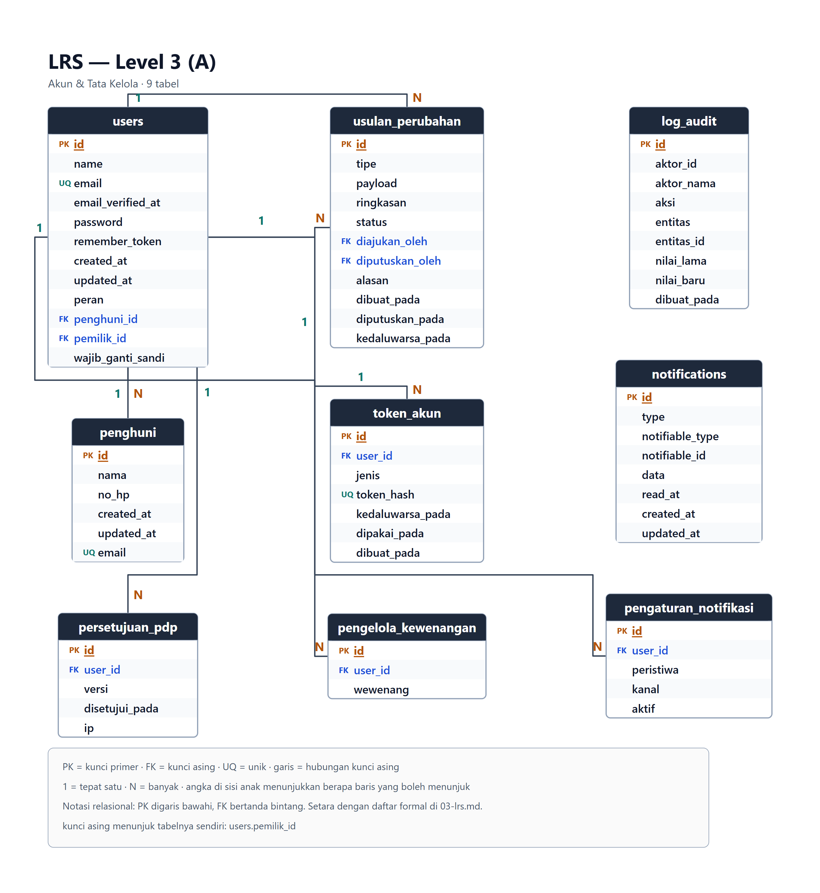
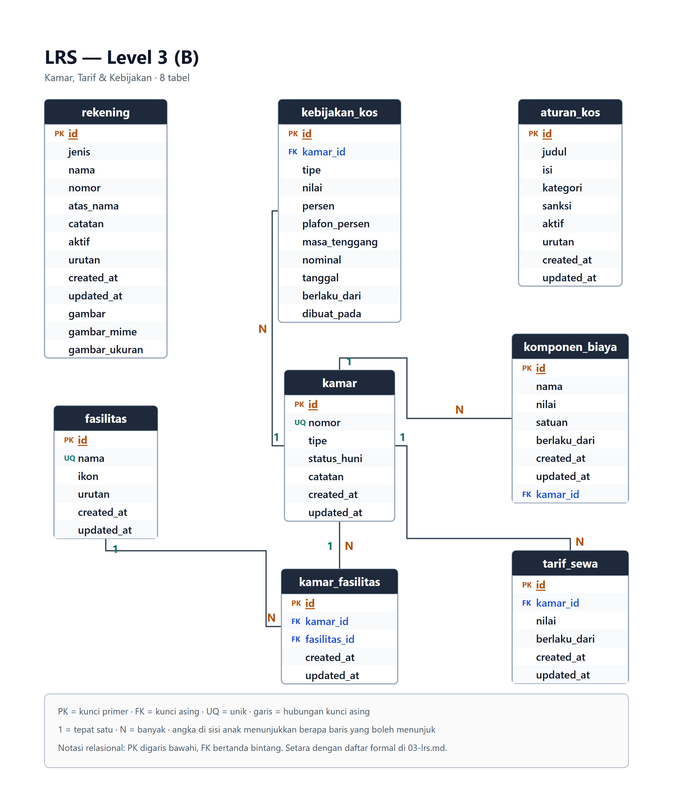
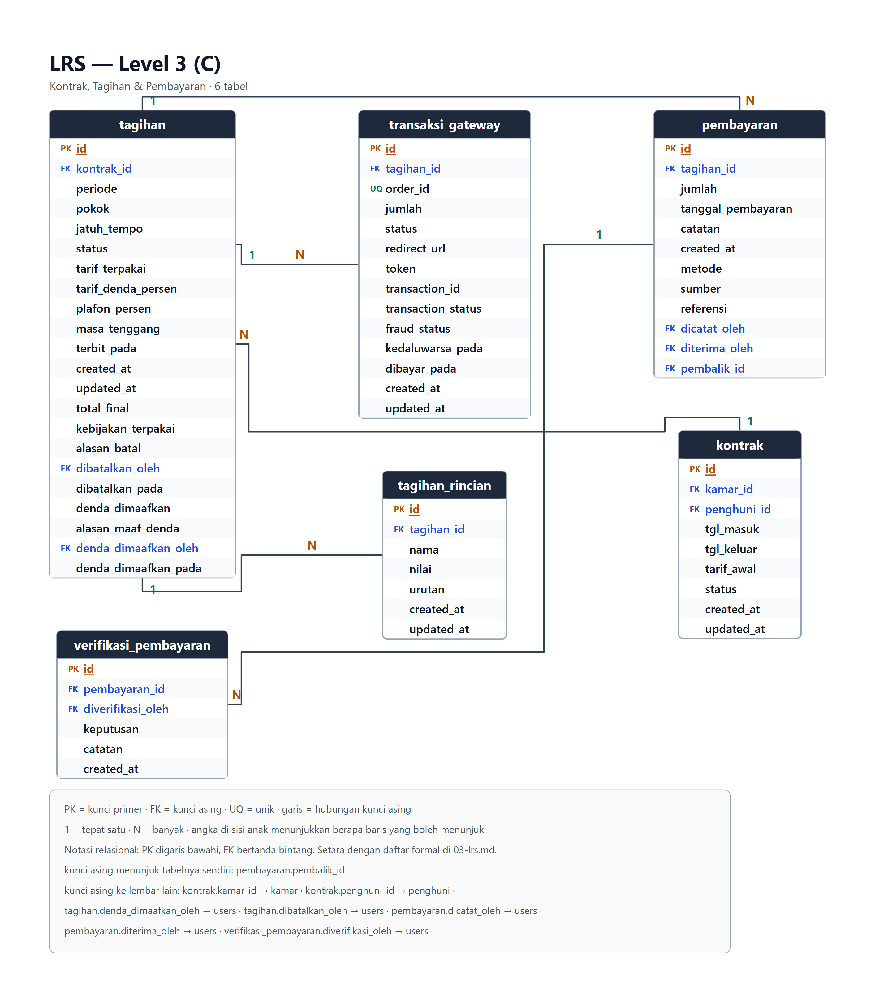

# BAB IV

## IMPLEMENTASI DAN PENGUJIAN

### 4.1. Desain

#### 4.1.1. Basis Data

Berikut adalah perancangan basis data menggunakan metode Normalisasi. Hasil akhirnya adalah 23 tabel, 201 kolom, dan 26 kunci asing, yang seluruhnya dipakai aplikasi — bukan rancangan di atas kertas.

1. Unnormalized Form (NF0)

Data transaksi harian dikumpulkan apa adanya, mengikuti bentuk pembukuan yang dipakai pemilik kos sebelum sistem ini ada: satu buku, satu baris per pembayaran, tanpa aturan. Terlihat data penghuni, kamar, dan fasilitas terus berulang di setiap baris, dan satu sel memuat lebih dari satu nilai.

*Gambar 4.1 Unnormalized Form*

Catatan perbaikan pada tahap ini:

- **Kelompok data berulang.** Satu sel "Fasilitas Kamar" memuat tiga nilai (AC, Kamar mandi dalam, Wi-Fi). Sel seperti ini tidak bisa dicari, diurutkan, atau dihitung — "berapa kamar yang punya AC?" tidak bisa dijawab tanpa membaca seluruh isi sel.
- **Redundansi.** Nama, nomor HP, dan tarif Budi diketik ulang setiap bulan dan setiap kali ia membayar. Pada 30 kamar × 12 bulan, nama pemilik yang sama tersimpan 12 kali.
- **Anomali pembaruan.** Nomor HP Sari berubah. Kalau hanya satu baris yang diperbaiki, dua baris lain menyimpan nomor lama — dan tidak ada cara menentukan mana yang benar.

2. First Normal Form (1NF)

1NF mewajibkan setiap kolom hanya berisi satu nilai dan tidak ada kelompok data yang berulang dalam satu baris. Kolom "Fasilitas Kamar" dipecah sehingga setiap fasilitas menempati barisnya sendiri. Hasilnya memang lebih panjang — inilah harga kejujuran data: satu baris kini berarti satu fakta, bukan tiga.

*Gambar 4.2 Normal Form 1*

Catatan perbaikan pada tahap ini:

- **Masalah yang sudah hilang.** Setiap sel kini bernilai tunggal, sehingga pertanyaan "berapa kamar yang punya AC?" bisa dijawab dengan satu query.
- **Masalah yang masih tersisa.** Redundansi belum hilang — justru bertambah. Budi sekarang punya tiga baris untuk satu bulan yang sama, dan nama, HP, serta tarif tetap diketik ulang di ketiganya. Satu pembayaran senilai 1.500.000 terbaca tiga kali, jadi total pendapatan bisa dihitung tiga kali lipat kalau salah menjumlahkan kolom "Dibayar".

3. Second Normal Form (2NF)

2NF menghilangkan ketergantungan sebagian: setiap atribut non-kunci harus bergantung pada SELURUH kunci primer, bukan hanya sebagian. Setelah 1NF, kunci baris ini sebenarnya gabungan (kamar, bulan) — dan nama penghuni hanya bergantung pada kamar, tidak pada bulan. Karena itu data penghuni dan kamar dipisahkan menjadi tabel tersendiri, dan yang tersisa hanyalah fakta yang benar-benar melekat pada kombinasi kamar–bulan, yaitu status dan jumlah pembayaran.

*Gambar 4.3 Normal Form 2*

Catatan perbaikan pada tahap ini:

- **Ketergantungan sebagian yang hilang.** `nama` dan `no_hp` sekarang hanya tersimpan sekali per penghuni, bukan sekali per pembayaran. Mengubah nomor HP cukup satu baris, dan tidak mungkin lagi ada dua versi nomor yang berbeda.
- **Yang tetap tinggal, dan disengaja.** `tarif` masih menempel pada kamar, padahal tarif bisa berubah tanpa kamarnya berubah. Selama ia disimpan di tabel kamar, kenaikan tarif akan menimpa sejarah: tagihan lama ikut terbaca dengan tarif baru. Itu bukan pelanggaran 2NF, melainkan ketergantungan transitif — dan itulah yang dibereskan 3NF.

4. Third Normal Form (3NF) — Hasil Akhir

3NF mewajibkan setiap kolom hanya bergantung pada kunci primer, dan tidak bergantung pada kolom lain yang bukan kunci. Dua ketergantungan transitif dipindahkan: (a) tarif bergantung pada kamar DAN tanggal berlaku, sehingga ia menjadi tabel riwayat `tarif_sewa`; (b) fasilitas adalah milik banyak kamar dan satu kamar punya banyak fasilitas, sehingga ia tidak boleh menempel di salah satunya. Hasil akhirnya adalah 23 tabel yang benar-benar dipakai aplikasi.

*Gambar 4.4 Normal Form 3*

Catatan perbaikan pada tahap ini:

- **Tarif tidak lagi menimpa sejarah.** `tarif_sewa` menyimpan tarif beserta tanggal berlakunya. Tagihan yang terbit bulan lalu tetap menunjuk tarif yang berlaku saat itu — inilah sebabnya tabel `tagihan` menyimpan `tarif_terpakai` sebagai potret, bukan sekadar menunjuk kamar.
- **Fasilitas tidak lagi diulang.** Tabel `kamar_fasilitas` menyelesaikan hubungan banyak-ke-banyak tanpa menyalin nama fasilitas ke setiap kamar.
- **Identitas dipisah dari data penghuni.** Tabel `users` menyimpan kredensial, `penghuni` menyimpan identitas. Pemisahan ini yang memungkinkan pemilik tidak pernah mengetahui kata sandi penghuni: yang ia buat adalah tautan aktivasi, bukan kata sandi.
- **Pembayaran dipisah dari tagihan.** Satu tagihan bisa dibayar beberapa kali sebagian. Kalau jumlah bayar disimpan di tabel tagihan, cicilan tidak mungkin dicatat tanpa menghapus riwayat sebelumnya.

**Entity Relationship Diagram (ERD)**

ERD menggambarkan entitas beserta relasinya memakai notasi Chen: persegi panjang untuk entitas, elips untuk atribut, belah ketupat untuk relasi. Yang digambar adalah tingkat logikal — dua belas entitas inti dengan atribut kuncinya. Tabel teknis seperti token aktivitas, jejak audit, dan kotak masuk notifikasi tidak digambar karena tidak menambah pemahaman konsep.

*Gambar 4.5 ERD Sistem Informasi Operasional Kos-Kosan*

> Notasi Chen. Dua belas entitas inti beserta atribut kuncinya. Tabel teknis (token_akun, log_audit, notifications, dan sejenisnya) sengaja tidak digambar karena tidak menambah pemahaman konsep; daftarnya ada di dokumen ERD.

**Logical Record Structure (LRS)**

LRS adalah kelanjutan ERD: entitas dan relasinya diubah menjadi struktur tabel dengan kolom, kunci primer, dan kunci asing. Kunci primer digarisbawahi dan kunci asing bertanda bintang.

LRS dipecah menjadi 3 lembar menurut alur data, bukan dipaksakan satu halaman. Pada satu lembar, 23 tabel menghasilkan huruf efektif sekitar 0,52% lebar A4 — kira-kira satu milimeter, tidak terbaca saat dicetak. Tiga lembar menaikkannya menjadi 1,28%–1,57%.

*Gambar 4.6 LRS (a) Akun dan Tata Kelola — 9 tabel*

> Kunci primer digarisbawahi, kunci asing bertanda bintang.

*Gambar 4.7 LRS (b) Kamar, Tarif, dan Kebijakan — 8 tabel*

> Memuat rantai tarif_sewa → kamar → kamar_fasilitas → fasilitas.

*Gambar 4.8 LRS (c) Kontrak, Tagihan, dan Pembayaran — 6 tabel*

> Memuat rantai kontrak → tagihan → tagihan_rincian → pembayaran.

Seluruh 23 tabel hasil normalisasi:

| Kelompok | Tabel |
|---|---|
| Data master | `users`, `penghuni`, `kamar`, `fasilitas`, `kamar_fasilitas`, `tarif_sewa`, `komponen_biaya`, `rekening` |
| Kebijakan dan aturan | `kebijakan_kos`, `aturan_kos` |
| Transaksi | `kontrak`, `tagihan`, `tagihan_rincian`, `pembayaran`, `verifikasi_pembayaran` |
| Gerbang pembayaran | `transaksi_gateway` |
| Tata kelola dan jejak | `pengelola_kewenangan`, `usulan_perubahan`, `log_audit`, `persetujuan_pdp` |
| Penunjang sistem | `token_akun`, `pengaturan_notifikasi`, `notifications` |

#### 4.1.2. Spesifikasi Data

Berdasarkan analisis masalah di atas, sistem yang dibangun membutuhkan struktur data sebagai berikut. Tabel di bawah memakai data contoh untuk memperlihatkan bentuk isinya; nama kolom dan tipenya diambil langsung dari basis data yang berjalan.

1. Entitas Akun Pengguna (t_users)

Menyimpan kredensial dan peran. Dipisahkan dari tabel penghuni supaya kata sandi tidak pernah berada di tabel yang dibaca untuk menampilkan data penghuni. Peran menentukan apa yang boleh dilakukan: pemilik, pengelola, atau penghuni.

| id | name | email | peran | wajib_ganti_sandi |
|---|---|---|---|---|
| 1 | Pemilik Kos | pemilik@kos.test | pemilik | tidak |
| 2 | Pengelola Kos | pengelola@kos.test | pengelola | tidak |
| 3 | Budi Santoso | penghuni@kos.test | penghuni | tidak |

*Tabel 4.1 Akun Pengguna*

2. Entitas Master Penghuni (t_penghuni)

Menyimpan identitas penghuni tanpa kredensial. Diperlukan agar nama dan nomor HP tidak diketik ulang di setiap tagihan dan setiap pembayaran.

| id | nama | no_hp | email |
|---|---|---|---|
| 1 | Budi Santoso | 081200000001 | penghuni@kos.test |
| 2 | Sari Dewi | 081200000002 | sari@kos.test |
| 3 | Rudi Hartono | 081200000003 | rudi@kos.test |

*Tabel 4.2 Master Penghuni*

3. Entitas Master Kamar (t_kamar)

Menyimpan kamar yang disewakan. Kolom status_huni menyatakan keadaan kamar saat ini, sedangkan riwayat siapa pernah menempatinya ada di tabel kontrak — dua hal berbeda yang tidak boleh dicampur.

| id | nomor | tipe | status_huni |
|---|---|---|---|
| 1 | A-01 | Standar | terisi |
| 2 | A-02 | Standar | terisi |
| 3 | A-03 | Besar | kosong |

*Tabel 4.3 Master Kamar*

4. Entitas Master Fasilitas (t_fasilitas)

Daftar fasilitas yang bisa dimiliki kamar. Namanya disimpan sekali di sini, lalu dihubungkan ke kamar lewat tabel kamar_fasilitas.

| id | nama | ikon | urutan |
|---|---|---|---|
| 1 | AC | ac | 10 |
| 2 | Kamar mandi dalam | mandi | 20 |
| 3 | Lemari | lemari | 30 |
| 4 | Meja belajar | meja | 40 |
| 5 | Wi-Fi | wifi | 50 |
| 6 | Parkir motor | parkir | 60 |

*Tabel 4.4 Master Fasilitas*

5. Entitas Riwayat Tarif (t_tarif_sewa)

Menyimpan tarif beserta tanggal berlakunya, bukan satu tarif terkini per kamar. Inilah yang membuat tagihan lama tetap benar setelah tarif dinaikkan: kenaikan tarif menambah baris baru, tidak menimpa baris lama.

| id | kamar_id | nilai | berlaku_dari |
|---|---|---|---|
| 1 | 1 | 1.500.000 | 2026-01-01 |
| 2 | 2 | 1.500.000 | 2026-01-01 |
| 3 | 3 | 1.750.000 | 2026-01-01 |

*Tabel 4.5 Riwayat Tarif*

6. Entitas Kontrak Sewa (t_kontrak)

Mencatat "siapa menempati kamar mana, sejak kapan". Tagihan selalu mengacu ke kontrak, bukan langsung ke kamar, sehingga riwayat penghuni sebelumnya tidak hilang ketika kamar berganti penghuni.

| id | kamar_id | penghuni_id | tgl_masuk | tarif_awal | status |
|---|---|---|---|---|---|
| 1 | 1 | 1 | 2026-01-15 | 1.500.000 | aktif |
| 2 | 2 | 2 | 2026-01-15 | 1.500.000 | aktif |

*Tabel 4.6 Kontrak Sewa*

7. Entitas Tagihan (t_tagihan)

Menyimpan tagihan per periode. Kolom tarif_terpakai adalah potret tarif dan kebijakan saat tagihan diterbitkan, sehingga mengubah tarif atau denda hari ini tidak mengubah tagihan bulan lalu.

| id | kontrak_id | periode | pokok | jatuh_tempo | status |
|---|---|---|---|---|---|
| 1 | 1 | 2026-01-01 | 1.500.000 | 2026-01-15 | lunas |
| 2 | 1 | 2026-02-01 | 1.500.000 | 2026-02-15 | terbit |
| 3 | 2 | 2026-01-01 | 1.500.000 | 2026-01-15 | terbit |

*Tabel 4.7 Tagihan*

8. Entitas Rincian Tagihan (t_tagihan_rincian)

Menguraikan tagihan menjadi baris-baris yang bisa dibaca penghuni: sewa, listrik, air, dan seterusnya. Tanpa tabel ini, penghuni hanya melihat satu angka besar tanpa tahu asalnya.

| id | tagihan_id | nama | nilai | urutan |
|---|---|---|---|---|
| 1 | 1 | Sewa kamar A-01 | 1.500.000 | 10 |
| 2 | 2 | Sewa kamar A-01 | 1.500.000 | 10 |
| 3 | 2 | Kebersihan | 50.000 | 20 |

*Tabel 4.8 Rincian Tagihan*

9. Entitas Pembayaran (t_pembayaran)

Mencatat setiap uang yang masuk, terpisah dari tagihan. Satu tagihan boleh dibayar beberapa kali. Pembatalan tidak menghapus baris, melainkan menambah baris bernilai negatif yang menunjuk baris aslinya lewat pembalik_id — supaya jejak uang tidak bisa hilang.

| id | tagihan_id | jumlah | tanggal_pembayaran | metode | sumber |
|---|---|---|---|---|---|
| 1 | 1 | 1.500.000 | 2026-01-10 | transfer | manual |
| 2 | 3 | 1.000.000 | 2026-01-14 | qris | gateway |
| 3 | 3 | 500.000 | 2026-01-16 | tunai | manual |

*Tabel 4.9 Pembayaran*

### 4.2. Pendukung

#### 4.2.1. Spesifikasi Hardware dan Software

Untuk mengimplementasikan rancangan basis data ini, dibutuhkan spesifikasi minimal sebagai berikut:

A. Perangkat Keras (Hardware)

- Processor: Intel Core i3 atau setara (aplikasi berjalan di atas Docker, bukan langsung di sistem operasi).
- RAM: minimal 4 GB untuk menjalankan aplikasi; 8 GB bila ingin menjalankan seluruh layanan sekaligus dengan nyaman.
- Penyimpanan: SSD 250 GB.
- Monitor, keyboard, dan mouse.
- Jaringan internet untuk verifikasi pembayaran melalui gerbang pembayaran.

B. Perangkat Lunak (Software)

- Sistem operasi: Windows 10/11, macOS, atau Linux.
- Docker Desktop — menjalankan PostgreSQL 16, PHP 8.3, nginx, dan Mailpit sekaligus.
- PostgreSQL 16 sebagai sistem manajemen basis data.
- PHP 8.3 dan Laravel 12 sebagai kerangka kerja antarmuka pemrograman.
- Node.js 22 dan Vue 3 untuk antarmuka pengguna.
- Google Chrome atau Microsoft Edge untuk mengakses aplikasi dan menjalankan uji otomatis.
