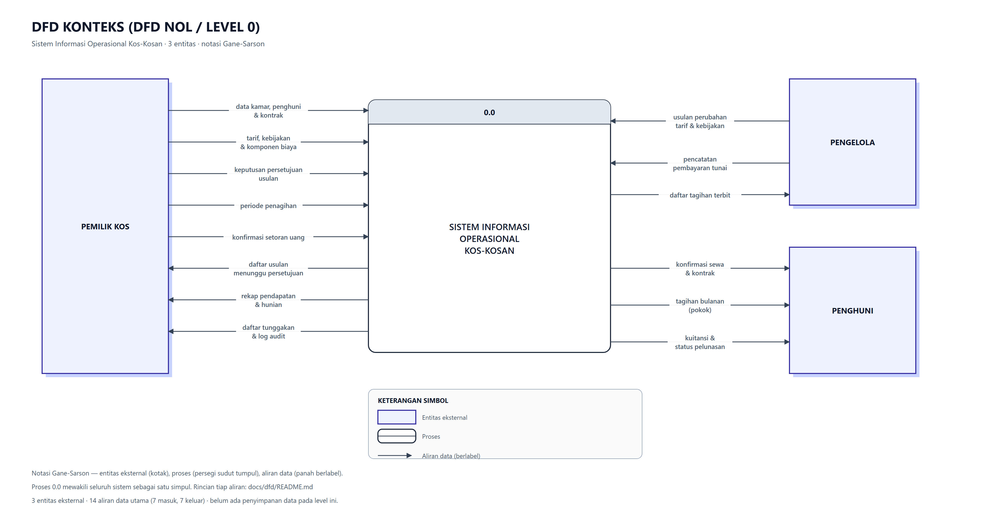

# DFD Konteks (Level 0) — Sistem Informasi Operasional Kos-Kosan

> **Dibangkitkan, jangan disunting tangan.** Jalankan
> `node docs/akademik/build.js && node docs/akademik/build-dokumen.js`.
>
> Gambar ini **tidak menggambar ulang** DFD proyek: ia memanggil
> `docs/dfd/dfd-gambar.js` dengan data dari `docs/dfd/dfd-data.js`. DFD
> teknis (`docs/dfd/`) tetap satu-satunya sumber; berkas ini hanya menyajikan
> ulang level 0 dalam format yang diminta template dosen.

## 1. Diagram

Berkas: `02-dfd-konteks.svg` (vektor) dan `02-dfd-konteks.png` (2x).

Notasi **Gane-Sarson**: entitas eksternal sebagai kotak, proses sebagai persegi
sudut tumpul dengan pita nomor, aliran data sebagai panah berlabel. Versi
Yourdon/DeMarco untuk gambar yang sama ada di `docs/dfd/01-dfd-konteks-yourdon.svg`.

## 2. Proses Sentral

Proses tunggal **0.0 Sistem Informasi Operasional Kos-Kosan** mewakili seluruh
sistem sebagai satu simpul. Pada level ini belum ada penyimpanan data — D1–D6
muncul di level 1, dan jumlah aliran batas di kedua level sengaja sama
(14) supaya tidak ada aliran yang hilang saat dekomposisi.

## 3. Matriks 14 Aliran Data Utama

### A. Aliran Data Masuk (Input ke Proses Sentral 0.0)

| Kode | Dari | Ke | Nama aliran | Struktur data |
|---|---|---|---|---|
| **I-1** | Pemilik Kos | Proses 1.0 | data kamar, penghuni & kontrak | `nomor_kamar, tipe, nama, no_hp, email, tgl_masuk` |
| **I-2** | Pemilik Kos | Proses 2.0 | tarif, kebijakan & komponen biaya | `kamar_id, nilai, berlaku_dari (tarif) · tipe, nilai, angka_pendukung, kamar_id (kebijakan)` |
| **I-3** | Pemilik Kos | Proses 2.0 | keputusan persetujuan usulan | `usulan_id, keputusan, alasan` |
| **I-4** | Pemilik Kos | Proses 3.0 | periode penagihan | `periode (bulan + tahun)` |
| **I-5** | Pemilik Kos | Proses 4.0 | konfirmasi setoran uang | `tagihan_id, tanggal, jumlah, metode, diterima_oleh` |
| **I-6** | Pengelola | Proses 2.0 | usulan perubahan tarif & kebijakan | `jenis, tipe, nilai_baru, alasan, diajukan_oleh` |
| **I-7** | Pengelola | Proses 4.0 | pencatatan pembayaran tunai | `tagihan_id, tanggal, jumlah, metode=tunai, diterima_oleh` |

### B. Aliran Data Keluar (Output dari Proses Sentral 0.0)

| Kode | Dari | Ke | Nama aliran | Struktur data |
|---|---|---|---|---|
| **O-1** | Proses 1.0 | Penghuni | konfirmasi sewa & kontrak | `kontrak_id, kamar, tgl_mulai, tarif_awal` |
| **O-2** | Proses 2.0 | Pemilik Kos | daftar usulan menunggu persetujuan | `usulan_id, tipe, nilai_lama, nilai_baru, batas_waktu` |
| **O-3** | Proses 3.0 | Penghuni | tagihan bulanan (pokok) | `periode, rincian[], pokok, total, jatuh_tempo` |
| **O-4** | Proses 3.0 | Pengelola | daftar tagihan terbit | `periode, daftar_tagihan[], jumlah_terbit` |
| **O-5** | Proses 4.0 | Penghuni | kuitansi & status pelunasan | `pembayaran_id, tanggal, jumlah, sisa_tunggakan` |
| **O-6** | Proses 5.0 | Pemilik Kos | rekap pendapatan & hunian | `periode, total_pendapatan, jumlah_transaksi, occupancy_rate` |
| **O-7** | Proses 5.0 | Pemilik Kos | daftar tunggakan & log audit | `daftar_tunggakan[], kategori_umur, baris_audit[]` |

Jumlahnya **7 masuk dan 7 keluar**.
Angka itu diperiksa `build.js` setiap kali gambar dibangun; bila data DFD
berubah dan jumlahnya tidak lagi 14, build gagal dan
dokumen ini tidak ditulis.

## 4. Mengapa Bentuknya Begini

**Tiga entitas, bukan dua.** Pemilik dan pengelola dipisahkan karena
perbedaannya mengubah aliran data secara nyata: pengelola mengusulkan (I-6) dan
pemilik memutuskan (I-3). Menggabungkan keduanya hanya menyederhanakan gambar,
sementara kenyataan sistemnya tetap punya dua peran dengan wewenang berbeda.

**Penghuni tanpa aliran masuk data.** Portal penghuni hampir seluruhnya
baca-saja. Pendaftaran sewa dan pencatatan uang dilakukan pemilik atau
pengelola, jadi tidak ada data yang mengalir *dari* penghuni ke sistem. Satu
tindakan ia mulai sendiri — membuka tautan bayar daring — tidak membawa data:
uangnya baru tercatat setelah gerbang pembayaran menyatakan settlement lewat
webhook, dan webhook itu bukan penghuni. Aliran masuk dari penghuni akan
menggambarkan fitur yang tidak ada.

**Dua aliran keluar ke pemilik dari proses 5.0.** Rekap pendapatan (O-6) dan
daftar tunggakan serta log audit (O-7) dipisah supaya jumlah aliran di level 0
dan level 1 seimbang, dan supaya log audit punya jalan keluar — tanpa O-7,
penyimpanan D6 menjadi *black hole* yang ditulis tiga proses tetapi tidak
pernah dibaca.

## 5. Rincian Lanjutan

| Dokumen | Isi |
|---|---|
| `docs/dfd/README.md` | Kamus data, tabel aliran lengkap, alasan tiap proses |
| `docs/dfd/02-dfd-level-1.svg` | Dekomposisi menjadi proses 1.0–5.0 dan D1–D6 |
| `docs/dfd/03-dfd-level-2.md` | Dekomposisi proses 3.0 (penagihan) dan 4.0 (pembayaran) |
