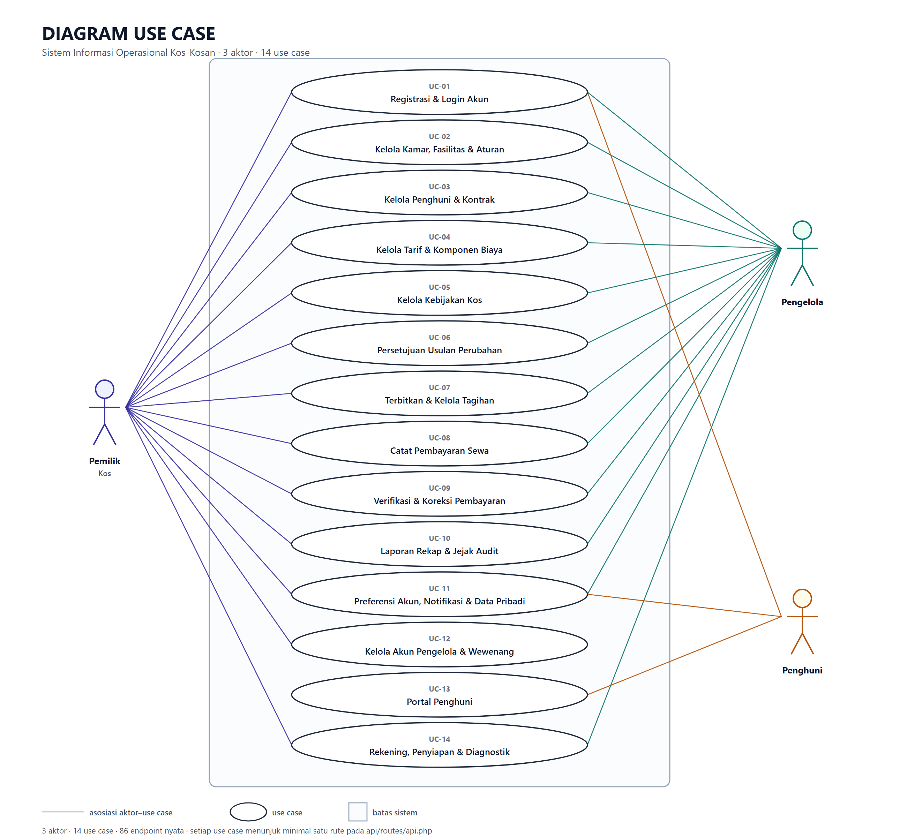

# Diagram Use Case — Sistem Informasi Operasional Kos-Kosan

> **Dibangkitkan, jangan disunting tangan.** Jalankan
> `node docs/akademik/build.js && node docs/akademik/build-dokumen.js`.
> Sumber: `usecase-data.js` (semantik) dan `usecase-gambar.js` (gambar).

## 1. Diagram



Berkas: `01-use-case.svg` (vektor) dan `01-use-case.png` (2x, siap tempel).

## 2. Aktor

1. **Pemilik Kos** (`pemilik`) — Pemilik akun dan pemegang keputusan. Satu-satunya yang boleh menetapkan
   tarif, kebijakan, dan komponen biaya secara langsung, menyetujui usulan
   pengelola, memaafkan denda, serta menetapkan rekening tujuan setoran.

2. **Pengelola** (`pengelola`) — Akun yang dibuat pemilik dan diberi wewenang terbatas dari delapan wewenang
   yang tersedia. Mencatat pembayaran tunai yang ia terima, menerbitkan
   tagihan, dan mengusulkan perubahan tarif atau kebijakan — usulan itu baru
   berlaku setelah pemilik memutuskan.

3. **Penghuni** (`penghuni`) — Penerima informasi dan pembayar, bukan pemasok data. Portal penghuni hampir
   seluruhnya baca-saja: pendaftaran sewa dan pencatatan uang dilakukan
   pemilik atau pengelola. Satu-satunya aliran masuk darinya adalah membuka
   tautan bayar daring, dan uangnya baru tercatat setelah gerbang pembayaran
   menyatakan settlement.

## 3. Daftar 14 Use Case dan Endpoint Pendukungnya

Setiap use case menunjuk minimal satu endpoint nyata. Pemetaannya
**tertutup**: 80 endpoint pada `api/routes/api.php` terpakai habis, dan tidak
ada satu pun yang dipakai dua use case. `build.js` memeriksa ketiga hal itu
dan gagal bila tidak terpenuhi.

| Kode | Use Case | Endpoint (nama rute) |
|---|---|---|
| **UC-01** | Registrasi & Login Akun | `api.login`<br>`api.logout`<br>`api.me`<br>`api.lupa-sandi`<br>`api.periksa-token`<br>`api.atur-sandi`<br>`api.ganti-sandi` |
| **UC-02** | Kelola Kamar, Fasilitas & Aturan Kos | `kamar.index`<br>`kamar.store`<br>`kamar.show`<br>`kamar.update`<br>`kamar.fasilitas`<br>`fasilitas.index`<br>`fasilitas.store`<br>`fasilitas.update`<br>`fasilitas.destroy`<br>`aturan.index`<br>`aturan.store`<br>`aturan.update`<br>`aturan.destroy` |
| **UC-03** | Kelola Data Penghuni & Kontrak Sewa | `penghuni.index`<br>`penghuni.store`<br>`penghuni.show`<br>`penghuni.update`<br>`penghuni.kirim-ulang-aktivasi`<br>`kontrak.index`<br>`kontrak.store`<br>`kontrak.show`<br>`kontrak.akhiri` |
| **UC-04** | Kelola Tarif Sewa & Komponen Biaya | `tarif.index`<br>`tarif.store`<br>`tarif.berlaku`<br>`komponen.index`<br>`komponen.store` |
| **UC-05** | Kelola Kebijakan Kos | `kebijakan.index`<br>`kebijakan.store` |
| **UC-06** | Persetujuan Usulan Perubahan Tarif & Kebijakan | `usulan.index`<br>`usulan.setujui`<br>`usulan.tolak` |
| **UC-07** | Terbitkan & Kelola Tagihan Bulanan | `tagihan.index`<br>`tagihan.store`<br>`tagihan.terbitkan`<br>`tagihan.batal`<br>`tagihan.maaf-denda` |
| **UC-08** | Catat Pembayaran Sewa | `tagihan.bayar`<br>`pembayaran.index`<br>`pembayaran.penerima`<br>`pembayaran.tunai-saya`<br>`api.webhook.midtrans` |
| **UC-09** | Verifikasi & Koreksi Pembayaran | `pembayaran.verifikasi`<br>`pembayaran.pembalik` |
| **UC-10** | Laporan Rekap Pendapatan, Tunggakan & Jejak Audit | `rekap.index`<br>`tunggakan.index`<br>`audit-log.index` |
| **UC-11** | Kelola Preferensi Akun, Notifikasi & Hak Data Pribadi | `notifikasi.index`<br>`notifikasi.baca-semua`<br>`notifikasi.baca`<br>`pengaturan-notifikasi.show`<br>`pengaturan-notifikasi.update`<br>`api.persetujuan-pdp`<br>`pdp.data-saya`<br>`pdp.hapus-saya` |
| **UC-12** | Kelola Akun Pengelola & Wewenang | `pengelola.index`<br>`pengelola.store`<br>`pengelola.show`<br>`pengelola.update`<br>`pengelola.destroy`<br>`pengelola.kirim-ulang-aktivasi` |
| **UC-13** | Portal Penghuni | `penghuni.tagihan`<br>`penghuni.aturan`<br>`penghuni.rekening`<br>`tagihan.show`<br>`tagihan.denda`<br>`tagihan.bayar-daring` |
| **UC-14** | Kelola Rekening Tujuan Pembayaran & Diagnostik Sistem | `rekening.index`<br>`rekening.store`<br>`rekening.update`<br>`rekening.destroy`<br>`api.health`<br>`api.pemilik-saja` |

## 4. Matriks Hak Akses Aktor

| Aktor | 01 | 02 | 03 | 04 | 05 | 06 | 07 | 08 | 09 | 10 | 11 | 12 | 13 | 14 |
|---|---|---|---|---|---|---|---|---|---|---|---|---|---|---|
| **Pemilik Kos** | ✓ | ✓ | ✓ | ✓ | ✓ | ✓ | ✓ (a) | ✓ | ✓ | ✓ (b) | ✓ | ✓ | — | ✓ (c) |
| **Pengelola** | ✓ | ✓ | ✓ | ✓ | ✓ | ✓ | ✓ (a) | ✓ | ✓ | ✓ (b) | ✓ | — | — | ✓ (c) |
| **Penghuni** | ✓ | — | — | — | — | — | — | — | — | — | ✓ | — | ✓ (d) | — |

Angka pada matriks **diturunkan dari middleware**, bukan diketik bebas:
`build.js` membaca gerbang setiap endpoint (`peran:` dan `wewenang:`) lalu
membandingkannya dengan tabel di atas. Aktor yang tercantum padahal tidak bisa
memanggil satu pun endpoint bergerbang milik use case itu menggagalkan build,
dan begitu pula sebaliknya.

### Catatan kaki

- **(a) UC-07** — pemaafan denda (`POST /api/tagihan/{tagihan}/maaf-denda`)
  khusus pemilik; pengelola menerbitkan dan membatalkan tagihan, tidak
  memaafkan denda.

- **(b) UC-10** — rekap pendapatan (`GET /api/rekap`) khusus pemilik;
  pengelola membaca tunggakan dan — bila punya `baca_audit` — jejak audit.

- **(c) UC-14** — pengelola hanya membaca daftar rekening; menulis rekening
  khusus pemilik karena nomor rekening adalah alamat uang masuk.

- **(d) UC-13** — empat endpoint `/penghuni/*` dan `POST
  /api/tagihan/{tagihan}/bayar-daring` bergerbang `peran:penghuni`, sehingga
  UC-13 utuh hanya milik penghuni. Dua endpoint baca di dalamnya — `GET
  /api/tagihan/{tagihan}` dan `GET /api/tagihan/{tagihan}/denda` — hanya
  memakai `auth:sanctum` dan dipakai bersama: pemilik dan pengelola membukanya
  dari layar tagihan, penghuni dari portalnya. Yang membedakan bukan gerbang
  melainkan scope `Tagihan::terlihatOleh` (R-07): tagihan milik orang lain
  dijawab 404, bukan 403.

## 5. Mengapa Ada Use Case Berupa Gabungan

- **UC-01.** Autentikasi, pemulihan sandi, dan penggantian sandi wajib adalah satu pintu
  masuk yang sama bagi ketiga peran. Memecahnya menjadi tiga use case akan
  menggambarkan tiga pekerjaan berbeda, padahal penggunanya mengalami satu
  urutan yang sama.

- **UC-08.** Webhook gateway (`POST /api/webhook/midtrans`) ikut di sini karena ia
  peristiwa pencatatan uang yang sama, hanya pemicunya mesin bukan orang. Ia
  tidak bergerbang peran — pemanggilnya Midtrans, bukan pengguna — dan karena
  itu tidak menambah aktor mana pun; yang menjaganya tanda tangan SHA512 atas
  `order_id`, `status_code`, dan `gross_amount`.

- **UC-11.** Kesembilan peristiwa notifikasi dan tiga hak subjek data tidak membentuk
  alur tersendiri, tetapi ketiganya milik semua peran dan menyangkut akun
  sendiri, bukan data kos.

- **UC-14.** Menulis rekening khusus pemilik karena nomor rekening adalah alamat uang
  masuk; `/health` adalah diagnostik publik tanpa aktor, dan `/pemilik/saja`
  adalah pemeriksa middleware peran. Ketiganya tidak membentuk alur
  tersendiri, tetapi tetap harus punya rumah di diagram.

Memecahnya menjadi use case tersendiri akan menghasilkan kotak yang hanya
berbeda pada nama endpoint, dan diagram yang memetakan endpoint satu per satu
berhenti menjelaskan pekerjaan penggunanya. Ini keputusan pemilik, bukan
kelalaian: jumlah 14 sudah final.

## 6. Cara Membangun Ulang

```powershell
node docs/akademik/build.js          # 01-use-case.svg + 02-dfd-konteks.svg
node docs/akademik/build-dokumen.js  # tiga berkas .md
powershell -ExecutionPolicy Bypass -File docs/akademik/export-png.ps1   # PNG 2x
```

Ekspor PNG memakai Chrome/Edge headless, pola yang sama dengan
`docs/dfd/export-png.ps1`. Ukuran jendela harus sama dengan `TATA_LETAK.kanvas`
di `usecase-data.js`, kalau tidak gambar terpotong.
